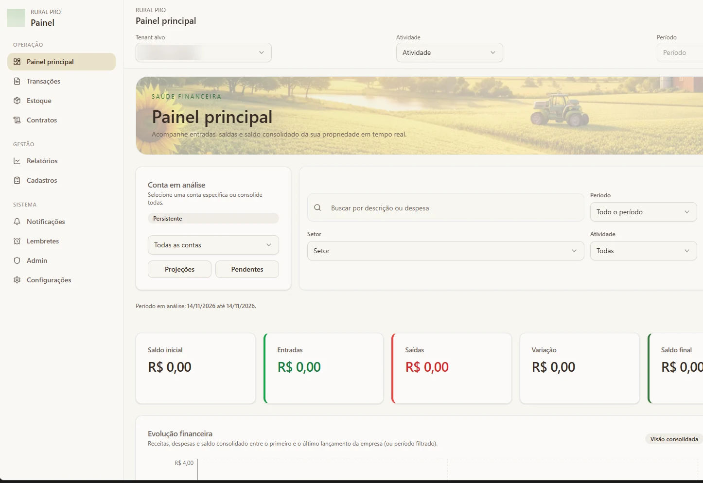

# edineizanol.dev

Portfólio pessoal. HTML, CSS e JavaScript puros, sem build. Publicado no GitHub Pages.

## Rodar localmente

Os módulos JS não carregam por `file://`, então use um servidor:

```bash
python3 -m http.server 8000
# abra http://localhost:8000
```

## Trocar os placeholders pelas imagens

Cada lugar de imagem tem um comentário `<!-- IMAGEM: imgs/nome.webp — descrição -->`.

1. Salve a imagem em `imgs/` com o nome indicado (WebP, ~1600px de largura, proporção 16:11).
2. Troque o bloco `<div class="media-placeholder">…</div>` logo abaixo do comentário por:

```html

```

Nos "Outros projetos", a imagem é opcional. Se usar, coloque o `` no lugar do ícone.

## Textos e traduções

- Português: direto no `index.html`.
- Inglês: `js/dict.js`, com a mesma chave do atributo `data-i18n`.

## Testes

```bash
npm install
npm test                         # tema, idioma, paridade das traduções, CSS
python3 tests/browser_check.py   # navegador: toggles, mobile, fallback sem JS, screenshots
```
